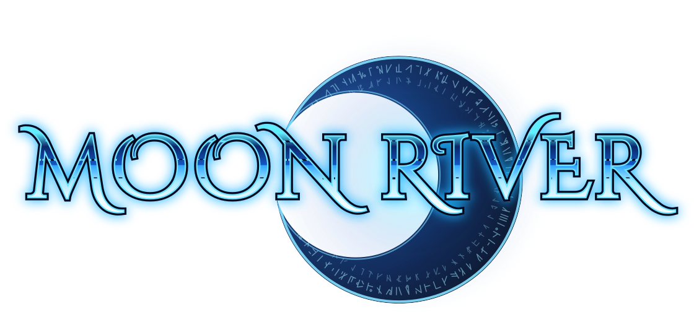

<p align="center">
  
</p>

<p align="center">
  <a href="https://recomplauncher.com"><picture><source media="(prefers-color-scheme: dark)" srcset="https://recomplauncher.com/assets/press/launcher/badge-light.svg"></picture></a>
</p>

# Moon River

A static recompilation of **Bayonetta 2** (Nintendo Switch, version 1.2 / update v131072) for PC, built on the
[Affogato](https://github.com/Zexyen/Affogato) / [Witch Time](https://github.com/Zexyen/Witch-Time) Rust build system,
Vulkan renderer, and SDL3 + RmlUi launcher, incorporating Bayonetta 2's port specifics and fixes from
[B2recomp](https://github.com/K0NL/B2recomp).

The game's AArch64 executable is statically translated to C on your own PC from your own Switch dump, compiled with
Clang into a native shared library (`build/game.so` / `game.dll`), and run on a re-implemented Nintendo Switch system
layer (threads, filesystem, save journaling, SDL3 input & audio, Maxwell-to-SPIR-V Vulkan renderer, and in-game PC
settings panel).

**No copyrighted game code, game assets, Nintendo SDK code, firmware, or keys are included in this repository.**
Everything derived from your dump is generated locally into `targets/`, `build/`, `cache/`, `runtime/gen/`, and
`userdata/` (all gitignored).

## Features

- **Native PC Vulkan renderer** with `VK_EXT_graphics_pipeline_library`, extended dynamic state 3, dynamic vertex input,
  device-local compute buffers, and write-watched texture memory (`userfaultfd` / `PAGEMAP_SCAN` on Linux,
  `MEM_WRITE_WATCH` on Windows).
- **Resolution scaling** from `0.5×` to `3.0×` over Bayonetta 2's native 720p (`1.5×` = 1080p, `2.0×` = 1440p,
  `3.0×` = 4K), adjustable live from the in-game PC Settings panel.
- **High frame rate (>60 fps, up to 120 fps)** (experimental): real-time frame clock, steady host pacing, smart frame
  counters, float timer overshoot preservation, closed-form smoothings, cinematic shot-hold timing, and time-channel 0
  slow-motion alignment.
- **Native Ultrawide (`21:9` / `32:9`)** (`aspect = wide` in `config/graphics.ini`, the launcher, or PC Settings):
  Hor+ 3D rendering, widened post-effect / DoF buffers, centered 16:9 HUD & menus, and 16:9 letterboxed movies.
- **HDR output** (`hdr = auto | on | off`, HDR10 / scRGB, configurable paper white and peak brightness).
- **In-game PC Settings panel** (`F1` or `Start + Select` on controller): live display, resolution, VSync, HDR, picture
  fit, controller prompt/layout settings, and Quit to desktop.
- **Controller & keyboard/mouse input** via SDL3, with automatic button prompt mods (`mods/`) and printed-letter face
  button prompt & action-ring rotation fixes.
- **Cutscene stability fixes**: safely releases and rebinds actors deleted mid-cutscene while respecting package unload
  countdowns.
- **Single-window SDL3 + RmlUi launcher** (`launcher/`) plus single-binary Rust build tool (`tools/mrbuild`) with zero
  Python dependency.

## Requirements

- A legitimate dump of **Bayonetta 2** (Nintendo Switch, v1.2 / update v131072), either:
  - **NSP / XCI files** dumped from your own console (your base game `.nsp`/`.xci` + Update 1.2 `.nsp`, or a merged `.xci`/`.nsp`, or a folder holding both) together with your own `prod.keys` (auto-detected beside the packages or in `~/.switch/prod.keys`, or passed with `--keys`). Moon River extracts everything locally and ships no keys or game data.
  - **An extracted dump folder** containing `exefs/` (`main`, `sdk`, `subsdk0`, `rtld`, `main.npdm`, …) and `romfs/`.
- **Build tools**: Rust (`cargo`), `clang` + `lld` (LLVM 19+), `cmake` + `ninja` (for the launcher).
- **System libraries** (Linux): SDL3, Vulkan headers, `glslang`, FFmpeg (`libavformat`, `libavcodec`, `libswscale`,
  `libswresample`, `libavutil`), OpenGL, FreeType.

## Quick Start

### 1. Build `mrbuild`

```bash
cargo build --release --manifest-path tools/mrbuild/Cargo.toml
```

### 2. Recompile your Bayonetta 2 dump

```bash
# Directly from your NSP/XCI files:
./tools/mrbuild/target/release/mrbuild setup --dump <base.nsp|.xci> --update <update-1.2.nsp> [--keys <prod.keys>]

# Or from an already-extracted dump folder:
./tools/mrbuild/target/release/mrbuild setup --dump /path/to/your/bayonetta2/dump
```

`mrbuild setup` verifies your dump, extracts ExeFS/RomFS from NSP/XCI (or copies/moves an extracted folder), converts NSOs to ELFs, applies any mods in `mods/`, extracts SDK 3.6.0 / NVN tables
and lifts pure SDK routines, lifts `main.elf` to C with Bayonetta 2's post-lift patches, compiles everything in
parallel, and links `build/game.so`, `build/libmoonriver.so`, and `build/moon-river-game`.

### 3. Build the launcher (optional)

```bash
cmake -S launcher -B build/launcher -G Ninja -DCMAKE_BUILD_TYPE=Release
cmake --build build/launcher
./build/moon-river-launcher
```

### 4. Run directly from the command line

```bash
MR_ROMFS="$PWD/targets/romfs" ./build/moon-river-game targets/exefs/main.elf
```

Press **F1** (or **Start + Select** on a controller) in-game to open the PC Settings panel.

## RecompLauncher

Moon River ships [`recomplauncher.json`](recomplauncher.json) in every release for [RecompLauncher](https://recomplauncher.com):
pick your NSP/XCI files (with your `prod.keys`) or extracted Update 1.2 dump folder there and Easy Setup builds the game
without a window (`moon-river-launcher --prepare`), exposes display, graphics, and controller settings on the game's
page, and launches with `moon-river-launcher --play`.

When started by RecompLauncher (`RECOMPLAUNCHER=1`), the built-in updater is disabled and settings, saves, logs (last
five runs), and shader caches are kept in `recompdata/` (`--data <folder>` or `MR_DATA` does the same anywhere), while
the built game stays in `build/` and `targets/`. Big Picture mode starts windowed installs borderless, and Auto button
prompts follow `RECOMPLAUNCHER_PAD` until a controller is seen. On Linux, releases are packaged both as `.tar.gz` and as
an `.AppImage` of the same folder (unpacked by RecompLauncher on install, or copied beside the AppImage on first run).

## Repository Layout

| Path | Description |
|---|---|
| `games/bayonetta2/` | Bayonetta 2 v1.2 dump hashes, SDK 3.6.0 lift roots, frame-counter & smoothing tables, Rust post-lift patcher (`post_lift.rs`), and game shim helpers (`game_shim_eh.c`). |
| `tools/mrbuild/` | Standalone Rust build tool (dump check, NSO→ELF, SDK/NVN table & proc discovery, AArch64→C lifter, parallel compiler, linker). |
| `runtime/` | Shared Switch HLE runtime (`nn::*` services, NVN→Vulkan/GL renderer, audio, SDL3 input, PC settings menu). |
| `launcher/` | C++17 SDL3 + RmlUi launcher UI. |
| `tests/`, `tools/lifter-check/` | Unit tests and Unicorn-based lifter verification. |

## Licence and Credits

Licensed under **GPL-3.0-or-later** — see [LICENSE](LICENSE) and [NOTICE.md](NOTICE.md).

Built from:
- [Affogato](https://github.com/Zexyen/Affogato) & [Witch Time](https://github.com/Zexyen/Witch-Time) (Zexyen)
- [B2recomp](https://github.com/K0NL/B2recomp) (K0NL)
- [ssbu-recomp](https://github.com/Denkishi/ssbu-recomp) (Denkishi)
